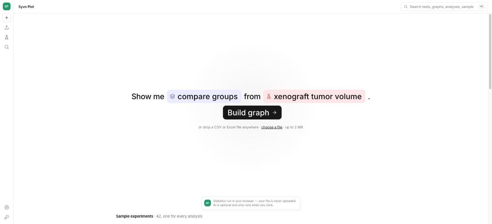
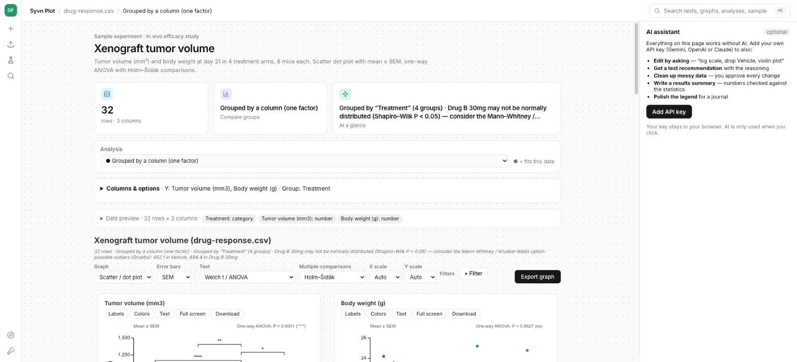
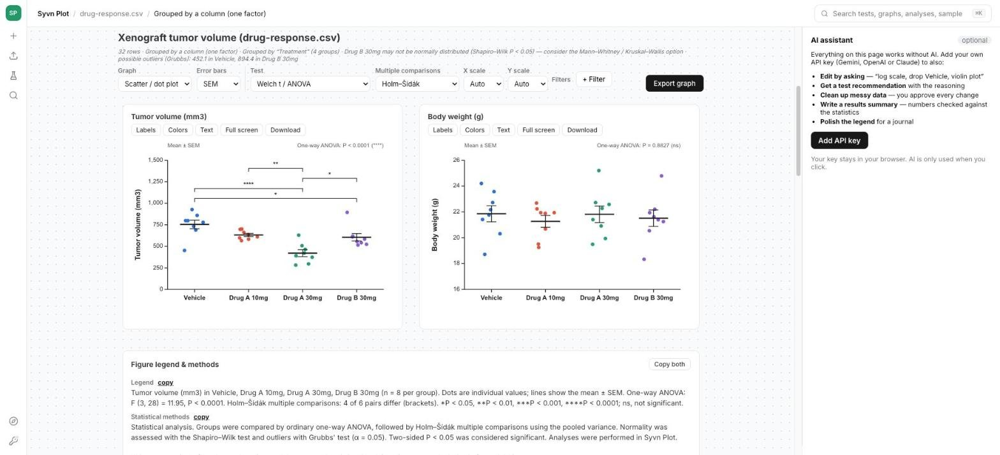

# Syvn Plot

**Lab data in, publication-ready graphs and statistics out.**

Drop in a CSV or Excel sheet from your experiment and Syvn Plot works out what kind of data it is. It draws the right graph and runs the right statistical test. It also writes the figure legend and methods paragraph for you. Everything runs in your browser, and your data never leaves your computer.



---

## What you can do with it

- **Turn a spreadsheet into a figure in seconds.** Drop a file, click **Build graph**, and you get a finished, labelled graph with significance brackets.
- **Get the statistics done properly.** You get t tests, ANOVA, non-parametric tests and multiple comparisons, plus normality and outlier checks on every group comparison. You choose the test from a dropdown, with no formulas or syntax to learn.
- **Fit curves.** Fit dose–response curves (EC50/IC50), standard curves with unknowns, enzyme kinetics, pharmacokinetics, growth rates and melting temperatures.
- **Make it journal-ready.** Use colour-blind-safe and journal palettes and edit any text on the graph. Export vector PDF, SVG or high-resolution PNG at exact journal column widths.
- **Copy a ready-written legend and methods paragraph.** It's generated from your actual results, ready to paste into a manuscript.
- **Learn by example.** 42 realistic sample experiments cover every analysis, from a xenograft study to a sandwich ELISA, RT-qPCR or a thermal-shift assay.
- **Optionally, ask an AI assistant** to restyle the graph in plain words or recommend a test. It can also clean up messy data or draft a results summary. It uses your own Gemini, OpenAI or Claude key and only runs when you click.



---

## How it works, in four steps

1. **Say what you want to see.** The home page is a sentence: *“Show me [compare groups] from [xenograft tumor volume].”* Click a chip to change it. You can also drop your own file anywhere on the page (CSV, TSV or Excel, up to 2 MB), and the sentence fills in from your columns. For example: *“Show me [a group comparison] of [Tumor volume] by [Treatment].”*
2. **Click Build graph.** Syvn Plot picks the analysis that fits your data, draws the graph and computes the statistics.
3. **Adjust anything.** You can change:
   - the graph style (bar, dots, box, violin), error bars (SD, SEM, 95% CI), the test and the multiple-comparisons method
   - axis scales (linear or log), and filter out groups
   - colours, titles and any text on the graph.

   Everything updates instantly.
4. **Export and write up.** Download the figure at journal or slide size and copy the generated legend and methods text.

New here? Click the **compass** icon in the left rail for a guided tour. Press **⌘K** (or Ctrl+K, or /) to search for anything: a test (“Mann–Whitney”), a graph (“violin”), an assay (“IC50”) or a feature (“export PDF”).



---

## 34 analyses, picked for you

Syvn Plot reads your columns (numbers, groups, dates, IDs, and plate-reader grids too) and suggests the analyses that fit. You can always switch analysis or reassign columns.

| Group | What's included |
|---|---|
| **Compare groups** | Replicates in columns · grouped by a column (with ÷ loading control / Renilla, % or fold of control) · paired / before–after · two factors (two-way ANOVA, grouped bars or split violin) · re-plot published summary data (mean, SD, N) |
| **XY & curves** | XY with replicate averaging (ΔF/F0, % of max, linear or initial-rate fit) · time course · dose–response (4PL, EC50/IC50) · standard curve + interpolate unknowns · Michaelis–Menten · pharmacokinetics (Cmax, Tmax, AUC, t½) · growth curves (µmax, doubling time, lag) · melt / thermal shift (Tm) · qPCR amplification (Cq) · chromatogram peaks |
| **Survival & counts** | Kaplan–Meier with log-rank test · contingency tables (chi-square, Fisher's exact) · parts of a whole (pie, donut) |
| **Distribution & correlation** | Histograms (linear or log bins) · correlation (Pearson, Spearman, correlation matrix) · Bland–Altman method comparison |
| **Heatmaps & multivariate** | Matrix heatmap with clustering · drug-combination synergy (Bliss) · PCA · scatter coloured by group (UMAP, t-SNE, flow dot plots, density shading for big data) |
| **Lab assays** | qPCR ΔΔCt fold change · qPCR standard curve & primer efficiency · assay quality (Z′, S/B, %CV) · 96/384-well plate map · volcano plot · MA plot |
| **Specialized plots** | Waterfall (% change per subject) · forest plot (OR, HR, effect sizes) · ranked horizontal bars (GO terms, top hits) |

### Statistics

| | |
|---|---|
| **Parametric** | Welch's, Student's and paired t tests · one-way, Welch, repeated-measures and two-way (type III) ANOVA |
| **Non-parametric** | Mann–Whitney · Wilcoxon signed-rank · Kruskal–Wallis · Friedman |
| **Multiple comparisons** | Holm–Šídák · Tukey HSD · Bonferroni · Dunnett (vs control) · Games–Howell (after Welch ANOVA) · Dunn's (after Kruskal–Wallis) |
| **Checks on every group comparison** | Shapiro–Wilk normality · Grubbs' outlier test, with a plain-language hint when a different test may suit your data better |
| **Fits & more** | 4-parameter logistic · Michaelis–Menten · linear regression · log-rank · chi-square · Fisher's exact · Pearson and Spearman · PCA · hierarchical clustering · non-compartmental PK |

---

## Make the figure yours

Every graph has its own toolbar:

| Button | What it does |
|---|---|
| **Labels** | Edit the title and axis names |
| **Colors** | 26 palettes (colour-blind-safe Okabe–Ito and Tol, grayscale, and Nature, Science, Cell, Lancet, NEJM and JAMA styles, Viridis…), recolour any single group, and 16 heatmap colour scales |
| **Text** | Click any text on the graph to change or hide it; add your own labels and drag them into place |
| **Full screen** | A large view with a live preview of each export size |
| **Download** | Journal single column (85 mm), 1.5 column (114 mm), double column (174 mm), square, portrait, 16:9 slide and A4. The graph is re-laid out for each size, not stretched |

**Export formats:** vector **PDF** (with an embedded font, so µ, Δ, ≥ and ′ print correctly), **SVG**, and **PNG** at 150, 300 or 600 dpi.

---

## Your data stays private

- **Files are read in your browser.** They are never uploaded to a server.
- **Statistics and graphs are calculated in your browser** too. No AI is involved.
- **The AI assistant is optional and off by default.** It only runs when you click an AI button. Even then it receives a *description* of your columns (names, types, ranges and a few example rows), never the whole file. The one exception is data cleanup: it asks your permission before sending a sample of rows.

---

## The optional AI assistant

Add your own API key (Google Gemini, OpenAI or Anthropic Claude) with the **key** icon in the left rail. The key is stored only in your browser and is never saved or logged by the server.

| Action | What it does | Safety net |
|---|---|---|
| **Edit by asking** | “log scale, drop Vehicle, violin plot” | Every change is checked against your data before it's applied, and there's an **Undo** button |
| **Which test should I use?** | Recommends an analysis and explains why, asking a question or two if your design is unclear | Nothing changes until you click **Apply recommendation** |
| **Clean up my data** | Merges inconsistent group spellings, turns “12 mg” into numbers, drops summary rows, fills merged cells, reshapes wide ↔ long… | Asks before sending a sample, shows a preview first, and has **Undo** |
| **Summarize results** | Writes a results paragraph | Every number is checked against the statistics Syvn Plot computed |
| **Polish legend** | Rewrites the legend and methods for a journal | Numbers and group names are checked against the original |

The AI never calculates statistics itself; it only works with numbers Syvn Plot has already computed. It uses each provider's low-cost model by default (`gemini-3.5-flash-lite`, `gpt-4.1-mini`, `claude-haiku-5-5`). A typical request costs a fraction of a cent.

---

## Run it yourself

You need [Node.js](https://nodejs.org) 20 or newer.

```bash
git clone https://github.com/devsams/syvn-plot.git
cd syvn-plot
npm install
npm run dev
```

Then open the address it prints (usually http://localhost:5173).

| Command | What it does |
|---|---|
| `npm run dev` | Start the app with live reload |
| `npm run build` | Type-check and build the static site into `dist/` |
| `npm run preview` | Serve the built site locally |
| `node scripts/make-samples.mjs` | Regenerate the sample experiment data |

**Optional server-side AI key.** You can give visitors a few free AI requests a day without their own key. Copy `.env.example` to `.env.local` and set a provider key plus `FREE_DAILY_LIMIT`. It's off (0) by default. Never commit real keys; `.env` files are git-ignored.

> **Hosting note:** the graphs, statistics and exports are a static site and can be hosted anywhere. The AI routes (`/api/ai-status`, `/api/verify-key`, `/api/chat`) currently run inside the Vite dev server. On a static host like Vercel the AI assistant won't work until those routes are moved to serverless functions.

---

## For developers

**Tech stack:** React 19, TypeScript and Vite 6, with [A2UI](https://github.com/google/A2UI) v0.9 for the graph surface. Charts are hand-written SVG and the statistics are hand-written TypeScript. Other pieces: PapaParse and SheetJS for parsing, jsPDF with svg2pdf.js for PDF export, driver.js for the tour, and `@anthropic-ai/sdk` plus the REST APIs for Gemini and OpenAI.

| Where | What |
|---|---|
| `src/lib/parse.ts` | Reads CSV/TSV/Excel and classifies each column (number, category, date, text); recognises plate-reader grids |
| `src/lib/analysis-defs.ts` | The catalogue of analyses (column roles, options); shared by the UI and the AI prompts |
| `src/lib/analyses.ts`, `analyses-extra.ts`, `stats.ts` | Detection scoring, one runner per analysis, and the statistics |
| `src/lib/figureText.ts` | Generates the figure legend and methods paragraph |
| `src/charts/` | SVG chart renderers |
| `src/research/`, `src/lib/graphSpec.ts` | The A2UI graph surface and its state |
| `src/lib/a2uiValidate.ts` | Strict validation of every AI-proposed change |
| `src/Hero.tsx` | The chip-sentence builder on the home page |
| `server/` | AI routes, prompts and provider adapters |
| `public/samples/`, `src/lib/samples.ts` | The 42 sample experiments |

**How the graph is driven.** Each graph lives in one long-lived A2UI surface called `research-graph`. Its whole state is a single `graphSpec` object, covering the analysis, chart type, columns, scales, filters, labels, colours and annotations. The setup panel, the live controls, the editing tools and the AI assistant all work the same way: each sends a small patch to `graphSpec`, and only the changed parts re-render. AI replies are A2UI messages. Each one is validated before anything changes: allowed operations and paths, locked component types, and every column, filter value and scale checked against your file. Problems come back as plain-language messages, and nothing is applied. To see the raw message log, open **Columns & options → Show A2UI messages**.
